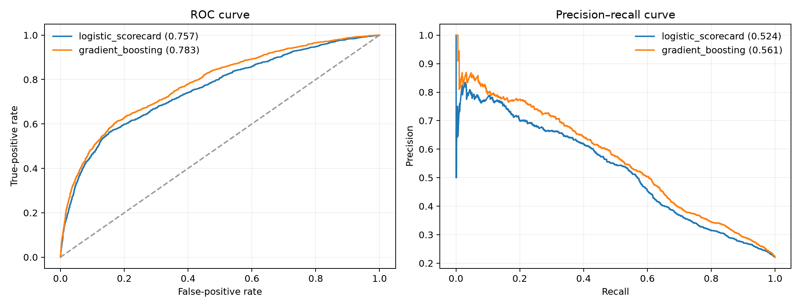
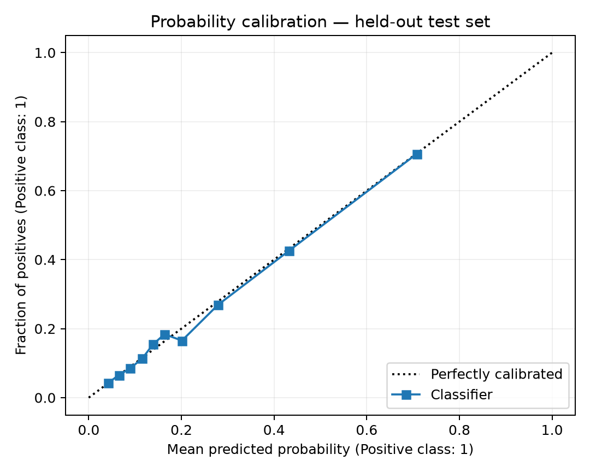
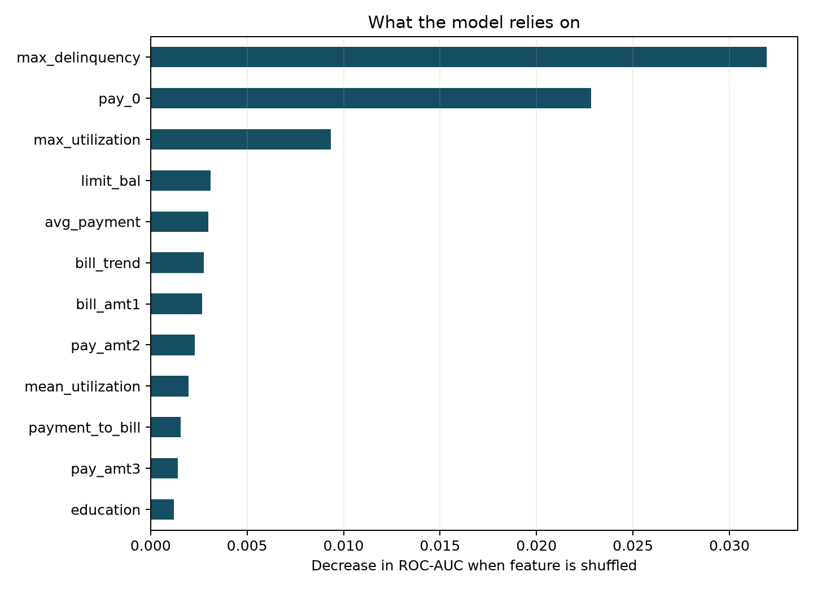
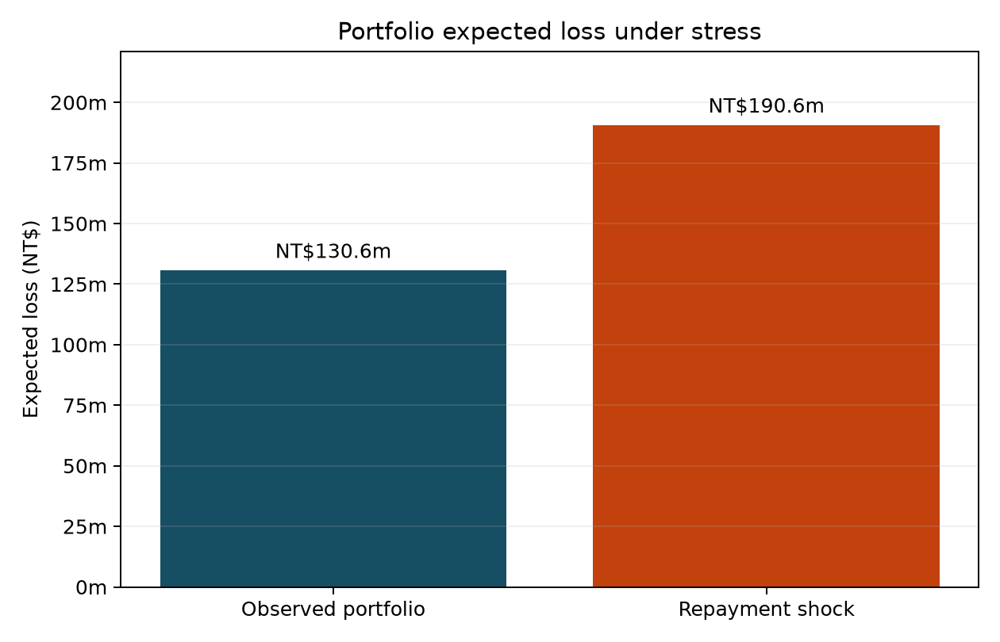

# CreditLens: From default probability to portfolio risk

## Research question

Can recent repayment behaviour identify accounts at elevated risk of next-month default, and how sensitive is portfolio expected loss to a broad deterioration in payment conditions?

## Executive finding

A calibrated gradient-boosting model outperformed the logistic scorecard on every held-out probability metric. On 7,500 records never used for training, it achieved **0.783 ROC-AUC**, **0.561 PR-AUC**, and a **0.134 Brier score**. The model is useful for risk ranking, but its error rate and historical data make it unsuitable for autonomous decisions.

Under a deliberately severe repayment shock—one additional step of delinquency, bills 10% higher, and payments 20% lower—the average estimated probability of default rose from **22.3% to 31.5%**. Using a 60% illustrative loss-given-default and credit limit as an exposure proxy, expected loss increased **46.0%**, from **NT$130.6m to NT$190.6m** on the test portfolio.

## Data

The analysis uses the UCI Default of Credit Card Clients dataset: 30,000 Taiwanese cardholders, six months of bills, payments and delinquency status, demographic fields, credit limits, and a next-month default outcome. The observed default rate is **22.12%**.

The final model does not use sex. That variable is retained only for a post-model diagnostic. The model uses the remaining raw fields plus interpretable behavioural features:

- Mean and maximum utilization
- Average payment and average bill
- Payment-to-bill ratio
- Maximum delinquency
- Count of delinquent and severely delinquent months
- Bill and payment trends

## Validation design

The data were divided into a stratified 75% training set and 25% held-out test set with a fixed random seed. Model selection used only mean five-fold cross-validation ROC-AUC inside the training set. The test set was reserved for one-time final evaluation. Both candidates were sigmoid-calibrated before that evaluation.

| Model | CV ROC-AUC | Test ROC-AUC | Test PR-AUC | Brier score |
|---|---:|---:|---:|---:|
| Logistic scorecard | 0.765 ± 0.008 | 0.757 | 0.524 | 0.140 |
| Gradient boosting | **0.787 ± 0.007** | **0.783** | **0.561** | **0.134** |

## Decision layer

The project separates probability estimation from the operational decision. A hypothetical manual-review flag assumes that missing a future default is five times as costly as reviewing a non-defaulting account. This yields a review threshold of 16.7%.

At that threshold, the selected model detects **74.0% of defaults** on the test set. Precision is **37.4%**, which means the flag is appropriate for prioritizing human review—not automatic rejection.

Probability quality matters because expected credit loss uses the full probability rather than a binary class:

`Expected loss = probability of default × loss given default × exposure at default`

## What the model learned

Permutation importance shows that maximum historical delinquency and the most recent repayment status are the dominant drivers. Utilization follows, while individual bill and payment amounts have smaller incremental effects. This ordering is financially coherent: repayment failure is a more direct risk signal than account size alone.

This is predictive evidence, not a causal claim. A high-importance variable can improve ranking without causing default.

## Stress test

The stress scenario applies the same mechanical shock to every test account:

1. Each monthly delinquency status worsens by one step, capped at eight months late.
2. All statement balances increase by 10%.
3. All payments decrease by 20%.

The model is then rerun on the shocked records. This produces a conditional vulnerability estimate, not an economic forecast.

## Protected-attribute audit

Sex was excluded from model inputs. In the held-out sample, the actual default rate was 21.2% for women and 23.5% for men; the model's average predicted probabilities were 22.0% and 22.9%, respectively. At the cost-sensitive threshold, review rates were 42.4% and 45.9%. The exported audit also reports group-specific true-positive and false-positive rates so differences in error allocation can be inspected directly.

These differences should be monitored, but this two-group comparison is not sufficient to establish fairness. A production review would require current representative data, intersectional analysis, error-rate parity checks, legal review, and monitoring over time.

## Limitations

- The records describe Taiwan in 2005 and may not generalize to current borrowers.
- Random validation measures interpolation, not future temporal drift.
- Credit limit is only a proxy for exposure at default.
- The 60% loss-given-default assumption is illustrative.
- The stress scenario is designed rather than historically estimated.
- Historical data can encode prior policy and social bias.

## Conclusion

The project demonstrates a complete risk-model workflow: data acquisition, financial feature engineering, transparent benchmarking, nonlinear modeling, calibration, cost-sensitive decisions, expected loss, model interpretation, stress testing, and governance. Its most important conclusion is not that one algorithm is “accurate,” but that useful finance models must connect predictive performance to probability quality, economic cost, and limitations.
